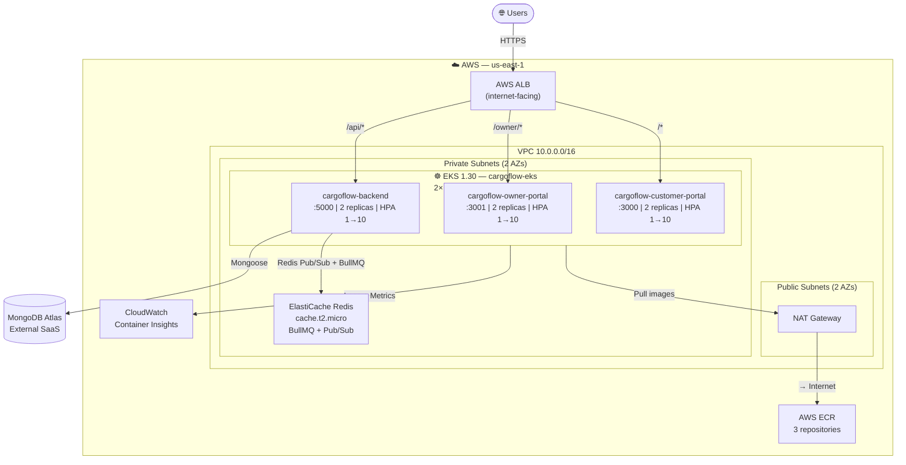
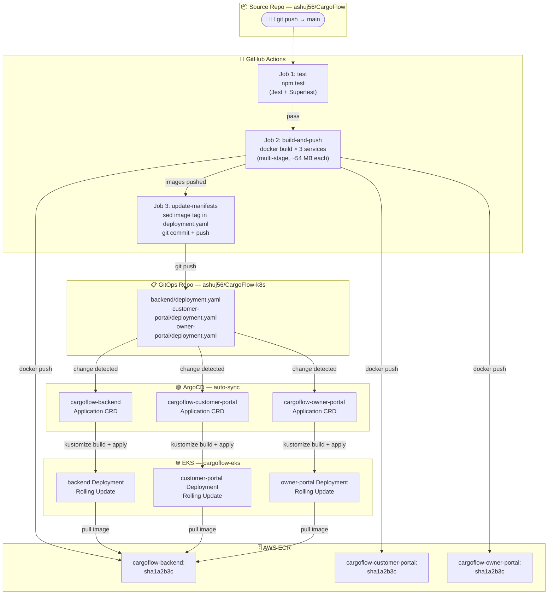

# 🚛 CargoFlow — Road Freight & Fleet Management Platform

> **Cloud-native microservices application** deployed on **AWS EKS** via a fully automated GitOps pipeline —
> **GitHub Actions (CI) → AWS ECR → ArgoCD (CD)** — with infrastructure managed entirely through **Terraform**.

[](https://terraform.io/)
[](https://aws.amazon.com/eks/)
[](https://argo-cd.readthedocs.io/)
[](https://github.com/features/actions)
[](https://docker.com/)
[](https://nodejs.org/)

---

## Platform Overview

CargoFlow digitizes the road freight lifecycle — booking, dispatch, GPS tracking, and GST-compliant invoicing — across two React portals (Customer + Fleet Owner) backed by a single Node.js/Express API.

| Service | Port | Image |
|:--------|:-----|:------|
| `cargoflow-backend` | 5000 | ECR → `cargoflow-backend:<sha>` |
| `cargoflow-customer-portal` | 3000 | ECR → `cargoflow-customer-portal:<sha>` |
| `cargoflow-owner-portal` | 3001 | ECR → `cargoflow-owner-portal:<sha>` |

---

## Infrastructure Architecture



---

## CI/CD Pipeline (GitOps)



### Three ArgoCD Applications (Independent)

| ArgoCD App | Watches | Sync Policy |
|:-----------|:--------|:------------|
| `cargoflow-backend` | `CargoFlow-k8s/backend/` | Auto-sync · Prune · Self-heal |
| `cargoflow-customer-portal` | `CargoFlow-k8s/customer-portal/` | Auto-sync · Prune · Self-heal |
| `cargoflow-owner-portal` | `CargoFlow-k8s/owner-portal/` | Auto-sync · Prune · Self-heal |

Each app has independent sync status, health monitoring, and rollback capability.

---

## Repository Layout

```
CargoFlow/                              ← This repo (source code + CI)
├── .github/
│   └── workflows/
│       └── ci.yml                     ← GitHub Actions (test → build → push → update manifests)
│
├── terraform/
│   ├── bootstrap/                     ← Run ONCE to create S3 + DynamoDB for remote state
│   │   ├── main.tf                    ← S3 bucket + DynamoDB (local backend)
│   │   ├── variables.tf
│   │   └── outputs.tf
│   │
│   ├── modules/
│   │   ├── networking/                ← VPC, 2× public + 2× private subnets, IGW, NAT, SGs
│   │   ├── eks/                       ← EKS 1.30, managed node group, OIDC, ALB controller, metrics-server
│   │   ├── ecr/                       ← 3 ECR repos with lifecycle policies (keep last 10 tags)
│   │   ├── redis/                     ← ElastiCache Redis cache.t2.micro
│   │   ├── cloudwatch/                ← Container Insights + log groups
│   │   └── argocd/                    ← ArgoCD Helm install + 3 Application CRDs (for_each)
│   │
│   ├── main.tf                        ← Root module, wires all modules together
│   ├── variables.tf                   ← Input variables
│   ├── outputs.tf                     ← Cluster name, ECR URLs, Redis endpoint, ArgoCD apps
│   ├── backend.tf                     ← S3 remote state backend
│   └── terraform.tfvars               ← Secret values (gitignored)
│
├── backend/
│   ├── k8s/                           ← Source-of-truth manifests (copied to CargoFlow-k8s)
│   └── Dockerfile                     ← Multi-stage Node.js image (~54 MB)
│
├── customer-portal/
│   ├── k8s/
│   └── Dockerfile
│
└── owner-portal/
    ├── k8s/
    └── Dockerfile

CargoFlow-k8s/                          ← Separate GitOps repo (ArgoCD watches this)
├── backend/
│   ├── deployment.yaml                ← image tag updated by GitHub Actions CI
│   ├── service.yaml
│   ├── hpa.yaml
│   ├── configmap.yaml
│   └── kustomization.yaml
├── customer-portal/                   ← same structure
├── owner-portal/                      ← same structure
└── ingress.yaml                       ← ALB Ingress routing all 3 services
```

---

## Terraform Modules

| Module | Resources Created | Key Config |
|:-------|:-----------------|:-----------|
| `bootstrap` | S3 bucket, DynamoDB table | Local backend, `prevent_destroy = true` |
| `networking` | VPC, 2× public/private subnets, IGW, NAT GW, EKS node SG, Redis SG | `10.0.0.0/16`, 2 AZs |
| `eks` | EKS 1.30 cluster, managed node group, OIDC provider, ALB controller (Helm), metrics-server (Helm) | `2× t3.micro`, scales 2→5 |
| `ecr` | 3 ECR repositories with lifecycle policies | Keeps last 10 tagged images |
| `redis` | ElastiCache subnet group + Redis cluster | `cache.t2.micro`, private subnets only |
| `cloudwatch` | Container Insights, log groups | `/aws/containerinsights/<cluster>/...` |
| `argocd` | ArgoCD namespace, Helm release, 3× Application CRDs | `for_each` loop, Kustomize auto-detect |

### Provider Versions

| Provider | Version |
|:---------|:--------|
| `hashicorp/aws` | `~> 5.0` |
| `hashicorp/kubernetes` | `~> 2.27` |
| `hashicorp/helm` | `~> 2.13` |
| `hashicorp/tls` | `~> 4.0` |
| `hashicorp/http` | `~> 3.4` |

---

## Kubernetes Workload Spec

Each service follows the same pattern:

| Resource | Config |
|:---------|:-------|
| `Deployment` | 2 replicas, `RollingUpdate` (maxSurge=1, maxUnavailable=0) |
| `HPA` | Scales 1→10 pods at 85% CPU / 80% Memory |
| `Service` | `ClusterIP` (ALB Ingress handles external traffic) |
| `ConfigMap` | Non-secret env vars (`NODE_ENV`, `PORT`, `VITE_API_URL`, etc.) |
| `Secret` | `backend-secrets` — created by Terraform from `terraform.tfvars` |
| Liveness probe | `GET /api/health` (backend), `GET /` (portals) |
| Readiness probe | Same paths, tighter timing |
| Security context | Runs as non-root `node` user (UID 1000) |

### ALB Ingress Routing

| Path | Service | Port |
|:-----|:--------|:-----|
| `/api/*` | `cargoflow-backend` | 5000 |
| `/owner/*` | `cargoflow-owner-portal` | 3001 |
| `/*` | `cargoflow-customer-portal` | 3000 |

---

## Deployment Runbook

### Prerequisites

| Tool | Version | Purpose |
|:-----|:--------|:--------|
| Terraform | `>= 1.6` | Infrastructure provisioning |
| AWS CLI | `v2.x` | Auth + EKS kubeconfig |
| kubectl | `1.30.x` | Cluster management |
| Helm | `v3.x` | Installed by Terraform (not run manually) |
| Docker | Latest | Local image builds |

### Step 1 — Bootstrap Remote State (Run Once)

```bash
cd terraform/bootstrap
terraform init
terraform apply
# Creates: cargoflow-tfstate-<account-id> (S3) + cargoflow-tfstate-lock (DynamoDB)
```

### Step 2 — Configure Secrets

```bash
cd terraform
cp terraform.tfvars.example terraform.tfvars
# Fill in: mongodb_uri, jwt_access_secret, jwt_refresh_secret, gmail_user, gmail_app_password
```

### Step 3 — Provision Infrastructure

```bash
cd terraform
terraform init       # connects to S3 backend
terraform plan       # preview all resources (~60 resources)
terraform apply      # ~15-20 mins
```

**Resources created:** VPC + subnets + NAT, EKS cluster + node group, ECR repos × 3,
ElastiCache Redis, ALB controller, metrics-server, ArgoCD + 3 Applications, CloudWatch,
K8s Secrets + ConfigMaps.

### Step 4 — Connect kubectl

```bash
aws eks update-kubeconfig --region us-east-1 --name cargoflow-eks
kubectl get nodes    # should show 2× Ready
```

### Step 5 — Set Up GitHub Actions Secrets

In `ashuj56/CargoFlow` → Settings → Secrets → Actions:

| Secret | Value |
|:-------|:------|
| `AWS_ACCESS_KEY_ID` | IAM user key (ECR-only permissions) |
| `AWS_SECRET_ACCESS_KEY` | IAM user secret |
| `AWS_REGION` | `us-east-1` |
| `ECR_REGISTRY` | `<account-id>.dkr.ecr.us-east-1.amazonaws.com` |
| `GITOPS_REPO_TOKEN` | GitHub PAT with `contents:write` on `CargoFlow-k8s` |

### Step 6 — First Deploy

```bash
# Push to main — GitHub Actions runs automatically
git push origin main

# Watch CI: GitHub → Actions tab
# Watch CD: ArgoCD UI (port-forward below)
kubectl port-forward svc/argocd-server -n argocd 8080:443
# http://localhost:8080  admin / <initial-password below>
kubectl get secret argocd-initial-admin-secret -n argocd \
  -o jsonpath="{.data.password}" | base64 -d
```

### Step 7 — Verify

```bash
# All pods running
kubectl get pods -n default

# ArgoCD sync status (all 3 should be Synced + Healthy)
kubectl get application -n argocd

# ALB URL
kubectl get ingress cargoflow-ingress -n default

# HPA status
kubectl get hpa -n default

# Logs
kubectl logs -l app=cargoflow-backend --tail=50
```

---

## Teardown

```bash
# Destroy all infra (EKS, ECR, Redis, ArgoCD, VPC...)
cd terraform && terraform destroy

# Bootstrap resources have prevent_destroy = true
# To destroy them, edit bootstrap/main.tf → remove lifecycle blocks → terraform destroy
```

> ⚠️ **EKS control plane costs $0.10/hr (~$72/mo). Always destroy when not in use.**

---

## Security

| Control | Implementation |
|:--------|:--------------|
| Secrets management | K8s `Secret` resources created by Terraform from `terraform.tfvars` (never in Git) |
| Pod security | Non-root `node` user (UID 1000), no `privileged` |
| Auth | JWT in `httpOnly` + `SameSite=Strict` cookies |
| Rate limiting | Redis-backed middleware on all API routes |
| Network isolation | EKS nodes + Redis in **private subnets only** |
| MongoDB access | Atlas IP whitelist → EKS NAT Gateway IP only |
| IAM | IRSA (pod-level IAM, no static keys in cluster) |
| ECR | Images scanned on push, lifecycle policy removes untagged images after 1 day |
| State | S3 bucket: versioned, AES-256 encrypted, public access fully blocked |
| CI credentials | Dedicated `cargoflow-ci` IAM user with ECR-write only (no EKS access) |

---

## Observability

| Tool | What It Shows |
|:-----|:-------------|
| **CloudWatch Container Insights** | Pod CPU/memory, node metrics, EKS control plane logs |
| **CloudWatch Log Groups** | `/aws/containerinsights/cargoflow-eks/application` — all pod stdout |
| **ArgoCD UI** | Sync status, health, diff view, rollback per service |
| **kubectl top** | Live pod resource usage (via metrics-server) |

```bash
# Open CloudWatch Container Insights
# AWS Console → CloudWatch → Container Insights → EKS → cargoflow-eks

# Live pod metrics
kubectl top pods -n default
kubectl top nodes
```

---

## Cost Estimate

| Resource | Type | Est. Monthly |
|:---------|:-----|:------------|
| EKS Control Plane | Managed | ~$72 |
| EC2 Nodes (2× t3.micro) | On-demand | ~$17 |
| NAT Gateway | — | ~$32 |
| ElastiCache Redis | cache.t2.micro | ~$0 (free tier) |
| ALB | Per LCU | ~$5–10 |
| ECR Storage | ~1 GB | ~$0.10 |
| S3 + DynamoDB (state) | Minimal | ~$0 |
| **Total** | | **~$126–130/mo** |
